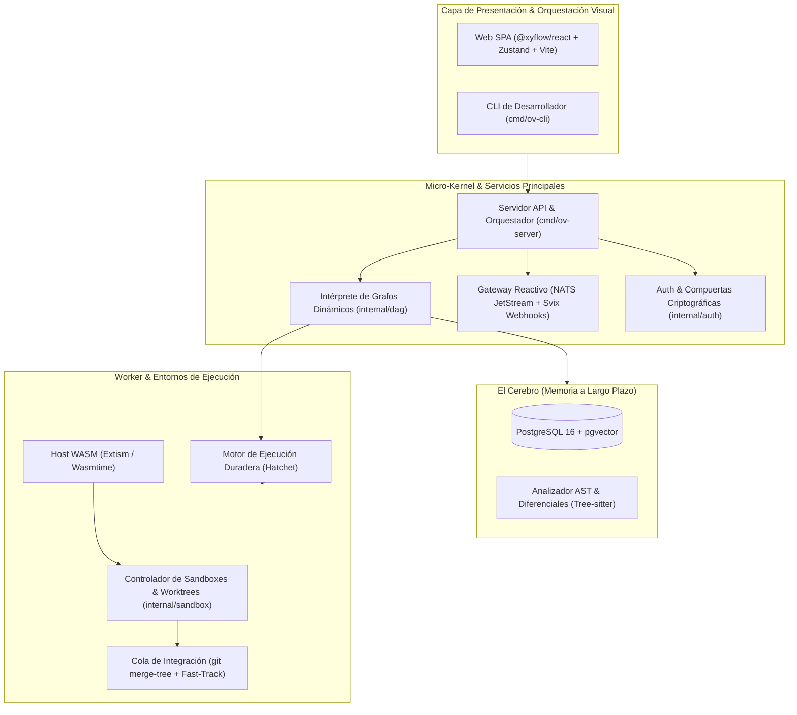

# OV-Factory (Software Factory Autónoma & Modular)

[](https://github.com/ov-factory/ov-factory/actions/workflows/ci-verify.yml)
[](https://github.com/ov-factory/ov-factory/actions/workflows/security-audit.yml)
[](https://securityscorecards.dev/viewer/?repo=github.com/ov-factory/ov-factory)
[](https://api.reuse.software/info/github.com/ov-factory/ov-factory)
[](https://opensource.org/licenses/Apache-2.0)

**OV-Factory** es una plataforma de código abierto modular y extensible para orquestar fábricas de software autónomas multi-agente. Combina memoria persistente a largo plazo sobre PostgreSQL (`pgvector`), aislamiento seguro de ejecución mediante Git Worktrees efímeros y contenedores rootless, ejecución distribuida con Hatchet, un ecosistema de plugins seguros en WebAssembly (WASM con Extism) y un editor visual de flujos interactivo con React Flow (`@xyflow/react`).

---

## Arquitectura del Sistema



---

## Requisitos Previos

- **Docker y Docker Compose** (versión 24.0+ / Compose v2.20+) o **Podman** con soporte rootless.
- **Go** 1.24+ (para desarrollo local del backend).
- **Node.js** 22+ y **pnpm** 9+ (para el frontend en `/web`).
- **Git** 2.40+ con soporte para worktrees.

---

## Guía de Despliegue en 3 Pasos

### 1. Clonar el Repositorio

```bash
git clone https://github.com/ov-factory/ov-factory.git
cd ov-factory
```

### 2. Levantar la Infraestructura Base

Inicia el stack unificado de almacenamiento y mensajería (PostgreSQL con pgvector, NATS JetStream, Hatchet y Svix):

```bash
docker compose -f deployments/docker-compose.yml up -d
```

### 3. Iniciar el Servidor y la Interfaz Visual

```bash
# Iniciar el backend y motor de orquestación
go run ./cmd/ov-server

# En otra terminal, iniciar la interfaz web
cd web
pnpm install
pnpm dev
```

Accede a la consola visual en `http://localhost:5173`.

---

## Estructura del Monorepo

Consulta [ESTRUCTURA.md](ESTRUCTURA.md) para conocer la disposición de paquetes, [INFRAESTRUCTURA.md](INFRAESTRUCTURA.md) para detalles del sandbox y [ROADMAP.MD](ROADMAP.MD) para la hoja de ruta por fases.

---

## Licencia

Este proyecto está licenciado bajo la licencia **Apache-2.0** y sigue rigurosamente el estándar **REUSE de la Free Software Foundation Europe (FSFE)**. Consulta [LICENSE](LICENSE) y la carpeta [LICENSES/](LICENSES/) para más información.
