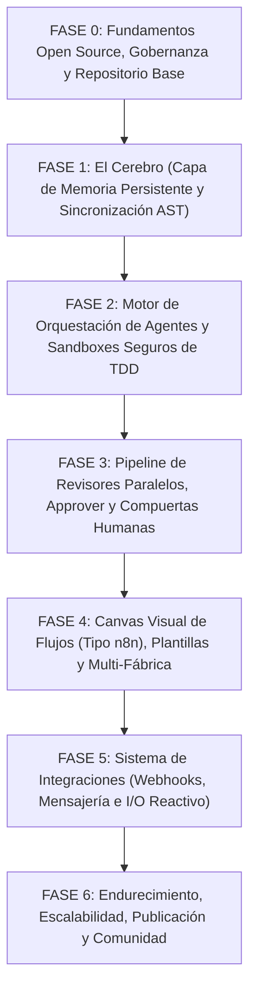

# Hoja de Ruta de Desarrollo: OV-Factory (Software Factory Autónoma & Modular)

- **Estado Actual:** Fase 0 (Concepción y Diseño de Arquitectura)
- **Licencia:** Apache-2.0 / Estándar REUSE
- **Objetivo:** Plataforma de código abierto modular y extensible para orquestar fábricas de software autónomas multi-agente con memoria persistente a largo plazo, ejecución aislada de código, editor visual de flujos e intervención humana granular.

---

## 1. Arquitectura General y Stack Tecnológico Sugerido

Para garantizar aislamiento, reactividad y extensibilidad sin ataduras propietarias:

- **Núcleo de Orquestación y Workflows:** Temporal.io o LangGraph/Prefect (motor de estados duraderos, reintentos exponenciales y pausas asíncronas para revisión humana).
- **Backend de Servicios & APIs:** Go / Node.js (TypeScript) o Python (FastAPI/AsyncIO) con arquitectura basada en plugins/eventos.
- **Memoria a Largo Plazo ("Cerebro"):** PostgreSQL + extensión `pgvector` (almacén relacional unificado para ADRs, AST de código, episodios históricos y embeddings semánticos).
- **Entornos de Ejecución Aislados (Sandbox):** MicroVMs / Contenedores efímeros con red restringida (gVisor, Firecracker, Docker con perfiles AppArmor/seccomp o integración con E2B/Modal auto-hospedado).
- **Frontend y Editor Visual:** React / Svelte con React Flow / Svelte Flow (interfaz drag-and-drop tipo n8n para diseño de pipelines y configuración de nodos).
- **Bus de Eventos y Mensajería:** Redis Streams o NATS / Apache Kafka para eventos internos; adaptadores para GitHub, GitLab, Slack, Discord y Webhooks arbitrarios.

---

## 2. Fases de Desarrollo



```text
┌──────────────────────────────────────────────────────────────────────────────┐
│  FASE 0: Fundamentos Open Source, Gobernanza y Repositorio Base              │
└──────────────────────────────────────┬───────────────────────────────────────┘
                                       ▼
┌──────────────────────────────────────────────────────────────────────────────┐
│  FASE 1: El "Cerebro" (Capa de Memoria Persistente y Sincronización AST)     │
└──────────────────────────────────────┬───────────────────────────────────────┘
                                       ▼
┌──────────────────────────────────────────────────────────────────────────────┐
│  FASE 2: Motor de Orquestación de Agentes y Sandboxes Seguros de TDD         │
└──────────────────────────────────────┬───────────────────────────────────────┘
                                       ▼
┌──────────────────────────────────────────────────────────────────────────────┐
│  FASE 3: Pipeline de Revisores Paralelos, Approver y Compuertas Humanas      │
└──────────────────────────────────────┬───────────────────────────────────────┘
                                       ▼
┌──────────────────────────────────────────────────────────────────────────────┐
│  FASE 4: Canvas Visual de Flujos (Tipo n8n), Plantillas y Multi-Fábrica      │
└──────────────────────────────────────┬───────────────────────────────────────┘
                                       ▼
┌──────────────────────────────────────────────────────────────────────────────┐
│  FASE 5: Sistema de Integraciones (Webhooks, Mensajería e I/O Reactivo)      │
└──────────────────────────────────────┬───────────────────────────────────────┘
                                       ▼
┌──────────────────────────────────────────────────────────────────────────────┐
│  FASE 6: Endurecimiento, Escalabilidad, Publicación y Comunidad              │
└──────────────────────────────────────────────────────────────────────────────┘
```

---

### Fase 0: Fundamentos Open Source, Gobernanza y Repositorio Base

**Meta:** Establecer un entorno de desarrollo reproducible, estándares de contribución y automatización de calidad desde el primer commit.

#### Funcionalidades y Entregables

1. **Configuración de Control de Versiones:**
   - Inicialización del repositorio bajo rama `main`.
   - Configuración de normalización de saltos de línea con `.gitattributes` (`* text=auto eol=lf`).
   - Configuración exhaustiva de `.gitignore` para monorepositorio o polirepositorio (exclusión de entornos, secretos, binarios y artefactos compilados).

2. **Marco Legal y Conformidad REUSE:**
   - Archivo `LICENSE` con Apache-2.0.
   - Declaraciones de cabecera SPDX en cada archivo (`SPDX-License-Identifier: Apache-2.0`).
   - Configuración del linter oficial de la FSFE (`reuse lint`) en integración continua.

3. **Archivos de Salud Comunitaria y Gobernanza:**
   - `README.md` estructurado: motivación, arquitectura en capas, guía rápida con un comando (`docker compose up`) y badges.
   - `CONTRIBUTING.md`: guías de estilo, setup local, cómo ejecutar la suite de pruebas y flujo de ramas (Trunk-Based / GitHub Flow).
   - `CODE_OF_CONDUCT.md`: Adopción del estándar Contributor Covenant v2.1.
   - `SECURITY.md`: Política de divulgación responsable de vulnerabilidades con clave PGP de contacto o reporte privado.
   - `CODEOWNERS`: Asignación inicial de módulos del core y sandboxing a los mantenedores.
   - Plantillas de issues (`bug_report.yml`, `feature_request.yml`) y pull request (`PULL_REQUEST_TEMPLATE.md`).

4. **CI/CD Inicial y Seguridad OpenSSF:**
   - Pipelines de GitHub Actions para validación sintáctica, linters (Prettier, ESLint, Ruff/Golangci-lint) y comprobación de tipos.
   - Configuración de Commitlint forzando *Conventional Commits* (ej. `feat:`, `fix:`, `refactor:`).
   - Verificación de permisos de mínimo privilegio en acciones (`permissions: contents: read`).
   - Configuración de escaneo de secretos local y remoto (Gitleaks / Trufflehog).

---

### Fase 1: El "Cerebro" (Memoria Persistente y Sincronización)

**Meta:** Crear el núcleo de almacenamiento de conocimiento que permite al pipeline recordar decisiones arquitectónicas pasadas, indexar código y almacenar lecciones aprendidas.

#### Funcionalidades y Entregables

1. **Modelado y Despliegue de Base de Datos:**
   - Contenedor e infraestructura para PostgreSQL con la extensión `pgvector`.
   - Esquema relacional y vectorial:
     - `architectural_rules`: Reglas arquitectónicas, restricciones técnicas y librerías permitidas/prohibidas.
     - `codebase_knowledge`: Fragmentos de código, resúmenes semánticos, tipos, interfaces, firmas de endpoints y vectores embeddings.
     - `task_episodes`: Historial de ejecuciones, problemas resueltos, causas de rechazos en reviews y lecciones aprendidas.

2. **Parser Sintáctico de Repositorios (Tree-sitter):**
   - Módulo de análisis estático del código base usando Tree-sitter para los lenguajes principales (TypeScript, Python, Go, Rust, Java).
   - Fragmentación lógica: no cortar por líneas arbitrarias de texto, sino por nodos del árbol sintáctico (clases, funciones, interfaces, schemas de base de datos).
   - Generación de contratos y firmas públicas para almacenamiento compacto.

3. **Mecanismo de Ingesta y Sincronización Bidireccional:**
   - **Ingesta inicial:** CLI para indexar un repositorio completo desde cero.
   - **Sincronización incremental (Git Watcher):** Worker que escucha webhooks de `push` a `main`, calcula `git diff --name-only HEAD~1` y recalcula únicamente los embeddings y resúmenes de los símbolos modificados.
   - **Sincronización de Reglas (ADR Sync):** Lector de carpetas de documentación (ej. `docs/adr/*.md`) que parsea decisiones arquitectónicas y las actualiza en la tabla de reglas activas.

4. **Capa de Recuperación Aumentada (RAG Específico de Código):**
   - Motor de búsqueda híbrido (Full-Text Search + Similitud Coseno por Vectores).
   - Mecanismo de filtrado de contexto por relevancia para inyectar solo la información indispensable al *Spec Writer*, reduciendo drásticamente la degradación de contexto y costes de tokens.

---

### Fase 2: Motor de Agentes y Sandboxes Seguros de TDD

**Meta:** Implementar el primer tramo del pipeline de ejecución: ingesta unificada, generación de especificaciones técnicas (Spec Writer) y codificación guiada por pruebas en entornos aislados (Builder).

#### Funcionalidades y Entregables

1. **Capa de Normalización de Entradas:**
   - Convertidor universal de entradas a un formato estructurado de tarea (`TaskContext`):
     - Extracción desde Issues (título, descripción, etiquetas).
     - Extracción desde Logs / Trazas de error (stack trace, runtime, contexto del fallo).
     - Extracción desde hilos de Chat / Mensajería.

2. **Agente "Spec Writer" (Diseñador Técnico):**
   - Integración con la Memoria a Largo Plazo: consulta automática de reglas arquitectónicas, contratos relacionados y episodios previos con fallos similares.
   - Generación de documentos SDD (*Software Design Document*) y TDD (*Test-Driven Development Plan*).
   - Descomposición funcional en tareas atómicas independientes (`Tarea 1`, `Tarea 2`, `Tarea N`), con dependencias explícitas y condiciones de éxito no negociables.

3. **Módulo de Sandbox Seguro (Ambiente Efímero de Ejecución):**
   - Motor de sandboxing basado en contenedores Docker/gVisor efímeros con ciclo de vida atado a la tarea.
   - Restricciones de seguridad por defecto:
     - Red deshabilitada o restringida por whitelist (prevención de exfiltración de credenciales).
     - Límites estrictos de memoria, CPU y cuotas de disco.
     - Montajes de volúmenes de solo lectura excepto para el directorio temporal de trabajo.

4. **Agente "Builder" (Ciclo TDD Autónomo):**
   - Ejecución tarea por tarea en el sandbox.
   - **Paso 1 (Red):** Generación de tests unitarios/integración que fallen según las especificaciones del *Spec Writer*.
   - **Paso 2 (Green):** Escritura y modificación del código fuente hasta que los tests pasen en verde dentro del sandbox.
   - **Paso 3 (Refactor):** Limpieza de código manteniendo los tests pasando.
   - Registro y telemetría de salida estándar, errores y diffs generados.

---

### Fase 3: Pipeline de Revisores Paralelos, Approver y Compuertas Humanas

**Meta:** Crear el sistema de auditoría concurrente con contexto limpio y la lógica de toma de decisiones para bifurcar entre despliegues automáticos o PRs con revisión humana.

#### Funcionalidades y Entregables

1. **Aislamiento de Revisores (Contexto Limpio):**
   - Arquitectura de ejecución concurrente: cada revisor corre de forma aislada, recibiendo únicamente el diff producido por el *Builder*, la especificación original y sus reglas específicas (sin arrastrar el historial de pensamientos o errores internos del Builder).

2. **Revisores Especializados:**
   - **Revisor de Seguridad:** Detección de patrones OWASP Top 10, inyecciones, dependencias vulnerables, credenciales quemadas en código y permisos excesivos.
   - **Revisor de Código / Arquitectura:** Validación de estándares de nombrado, complejidad ciclomática, cobertura de pruebas mínimas y respeto a los ADRs vigentes.
   - **Revisor de UI / UX:** Validación de consistencia de diseño, uso de componentes aprobados de la librería de diseño, responsividad y accesibilidad (a11y).

3. **Agente "Approver" y Lógica de Ponderación:**
   - Agregador de diagnósticos: combina las evaluaciones de todos los revisores en un informe consolidado.
   - **Bucle de Corrección (Feedback Loop):** Si se detectan violaciones críticas, el Approver reinyecta el feedback al *Builder* con un contador máximo de reintentos (ej. 3 iteraciones) para evitar bucles infinitos de coste.

4. **Compuerta de Revisión Humana (*Human-in-the-Loop Gate*):**
   - Motor de reglas deterministas para bifurcación:
     - **Bypass a `main` / Producción:** Solo si el cambio es clasificado de bajo riesgo (sin cambios de schema, sin cambios de auth, cobertura de tests $\ge 90\%$, 0 alertas de seguridad).
     - **Creación de Pull Request (PR):** Obligatoria si se modifican migraciones de base de datos, APIs públicas, módulos de autenticación o si el Approver tiene una confianza intermedia.
   - Integración con la API de GitHub/GitLab para abrir el PR con el resumen de los revisores embebido en la descripción.

5. **Cierre de Ciclo de Aprendizaje:**
   - Captura automática de comentarios y cambios realizados por el revisor humano durante la aprobación del PR.
   - Persistencia del desenlace en `task_episodes` dentro del *Cerebro* para retroalimentar ejecuciones futuras.

---

### Fase 4: Canvas Visual de Flujos, Plantillas y Multi-Fábrica

**Meta:** Desarrollar la interfaz visual interactiva tipo n8n que permita a los usuarios diseñar, modificar y correr múltiples fábricas de software en paralelo.

#### Funcionalidades y Entregables

1. **Editor Visual de Flujos (Canvas Interactivo):**
   - Editor drag-and-drop de nodos y conexiones (usando React Flow / Svelte Flow).
   - Nodos nativos configurables:
     - *Nodos de Entrada:* Webhook, GitHub Issue, Chat Listener, Cron Schedule.
     - *Nodos de Agente:* Spec Writer, Builder, Seguridad, UI/UX, Código, Approver.
     - *Nodos Lógicos:* Condiciones (If/Else), Evaluadores de Score, Selectores de Modelo (LLM Router).
     - *Nodos de Acción:* Git Commit, Git Push, Crear PR, Notificar Slack/Discord.
   - Modificación en caliente: capacidad de pausar una ejecución en vivo, alterar la ruta del flujo o editar la especificación generada antes de continuar.

2. **Sistema de Plantillas de Fábricas:**
   - Definición declarativa de flujos en formato YAML o JSON.
   - Catálogo de plantillas preconfiguradas:
     - *Fábrica Bugfix Express:* Flujo ligero para resolver errores en logs con auto-merge tras pasar tests.
     - *Fábrica Feature Completa:* Pipeline exhaustivo con TDD riguroso, 3 revisores y PR humano obligatorio.
     - *Fábrica Refactor & Doc:* Flujo centrado en análisis de complejidad y actualización de documentación sin tocar lógica de negocio.
   - Mecanismo de exportación e importación de plantillas entre repositorios.

3. **Motor Multi-Fábrica Concurrente:**
   - Aislamiento multitenant de fábricas sobre el mismo repositorio:
     - Capacidad de ejecutar varias fábricas concurrentes sobre distintas ramas sin colisiones de Git.
     - Asignación de prioridades de tareas y colas dedicadas por fábrica.
   - Vista de monitoreo global: tablero con estado en tiempo real de cada fábrica en ejecución (progreso de tareas, logs transmitidos vía WebSockets/SSE y consumo de tokens).

---

### Fase 5: Sistema de Integraciones (Webhooks, Mensajería e I/O Reactivo)

**Meta:** Conectar la fábrica con las herramientas diarias del equipo de desarrollo para interacción bidireccional continua.

#### Funcionalidades y Entregables

1. **Sistema de Webhooks Receptores y Emisores:**
   - Ingestores de eventos entrantes autenticados mediante HMAC / Secrets:
     - GitHub (Issues, Pull Requests, Workflow runs, Check suites).
     - GitLab (Issues, Merge Requests, Pipeline events).
     - Sentry / Datadog / OpenTelemetry (Alertas y excepciones capturadas en producción).
   - Emisores de webhooks genéricos para notificar sistemas externos sobre hitos del pipeline (ej. `task.completed`, `pr.ready_for_review`).

2. **Adaptadores de Mensajería Bidireccional:**
   - **Bots para Slack y Discord:**
     - Recepción de comandos de texto natural (ej. `/factory fix issue #102`).
     - Notificación interactiva cuando se requiere aprobación humana con botones de acción rápida (*Aprobar*, *Rechazar*, *Ver Diff*).
     - Hilos de discusión interactivos: capacidad de dialogar con el *Spec Writer* o el *Approver* dentro del hilo del chat antes de autorizar el merge.

3. **CLI Oficial de OV-Factory:**
   - Herramienta de línea de comandos para desarrolladores:
     - `ov-factory run --template bugfix --issue 42`
     - `ov-factory memory query "decisiones sobre auth"`
     - `ov-factory worker start` (para aportar capacidad de cómputo local al clúster).

---

### Fase 6: Endurecimiento, Escalabilidad, Publicación y Comunidad

**Meta:** Preparar la plataforma para adopción comunitaria masiva, despliegues autogestionados y producción estable.

#### Funcionalidades y Entregables

1. **Infraestructura de Despliegue Abierta:**
   - `docker-compose.yml` integral para levantar la plataforma completa (Postgres/pgvector, Backend, Frontend, Orquestador y Worker de Sandbox) en un solo paso en local o VPS.
   - Helm Charts oficiales y manifiestos de Kubernetes para despliegues a gran escala en producción.

2. **Sistema de Plugins y Extensibilidad Comunitaria:**
   - SDK para creación de nuevos agentes y revisores personalizados (ej. un revisor de compliance GDPR o un revisor de optimización de costes de infraestructura).
   - Contratos de interfaces estrictos en gRPC o OpenAPI para permitir plugins escritos en cualquier lenguaje.

3. **Métricas, Observabilidad y Control de Costes:**
   - Soporte nativo de OpenTelemetry para trazabilidad distribuida de cada paso de los agentes.
   - Panel de control de cuotas y consumo de tokens por LLM/proveedor (OpenAI, Anthropic, Ollama, modelos locales).
   - Modo *Fallback / Offline*: capacidad de operar enteramente con LLMs locales (Ollama / vLLM) en entornos sin acceso a internet o de alta confidencialidad.

4. **Automatización de Publicaciones y Releases:**
   - Configuración de *Release-Please* para gestión automática de `CHANGELOG.md` y versionado semántico (SemVer 2.0.0).
   - Pipeline de publicación de imágenes de contenedor en GitHub Container Registry (`ghcr.io`) con firmas criptográficas de Cosign (Sigstore) y atestaciones SBOM (Syft/Trivy).
   - Creación del portal de documentación comunitaria (con Mintlify, VitePress o Docusaurus).

---

## 3. Matriz de Entregables e Hitos (Milestones)

| Hito | Nombre | Entregable Clave | Criterio de Éxito |
| :--- | :--- | :--- | :--- |
| **M0** | *Ground Zero & Setup* | Repositorio, CI, licencias y directivas OpenSSF. | `reuse lint` pasa, CI verde, pre-commit activo. |
| **M1** | *The Persistent Brain* | Postgres + `pgvector`, sincronizador Tree-sitter y ADRs. | Búsqueda semántica e incremental operativa vía tests. |
| **M2** | *Isolated TDD Engine* | Sandboxes de ejecución y agentes Spec Writer + Builder. | Tarea generada desde un Issue ejecuta ciclo Red-Green en sandbox. |
| **M3** | *The Review Council* | Revisores en paralelo, Approver y compuerta PR/main. | Diffs auditados de forma concurrente con feedback loop funcional. |
| **M4** | *Visual Canvas & Multi-Factory* | Frontend drag-and-drop y soporte multi-fábrica. | Creación y ejecución de un pipeline completo desde la interfaz web. |
| **M5** | *Ecosystem Connectors* | Webhooks y bots bidireccionales (Slack/Discord/GitHub). | Disparo de corrección desde un mensaje de chat con botón de aprobación. |
| **M6** | *Production Release 1.0* | Docker Compose universal, Helm charts y firma de imágenes. | Instalación limpia desde cero con un comando y documentación pública. |
